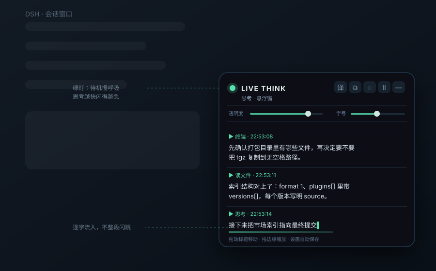

> Current installation: use the plugin market or the [v0.2.0 offline package](https://github.com/hcycyxx/dsh-think-overlay/releases/download/v0.2.0/dsh-think-overlay-0.2.0.tgz). The `@latest` command requires a separately verified npm publication.

<div align="center">
  <h1>DSH Think Overlay</h1>
  <p><strong>Pull DeepSeek Harness's live thinking into an overlay you can actually see and move.</strong></p>
  <p>Character-by-character streaming · Speed-linked status light · Auto EN→ZH</p>
  <p>
    <a href="README.md"></a>
    <a href="README.en.md"></a>
  </p>
  <p>
    <a href="https://github.com/hcycyxx/dsh-think-overlay/releases"></a>
    <a href="https://github.com/hcycyxx/dsh-think-overlay/stargazers"></a>
    <a href="LICENSE"></a>
  </p>
</div>

By default, thinking streams character by character into a translucent always-on-top window pinned to the bottom-right of the screen. The green status light at the top-left breathes slowly when idle and blinks faster as the typing speeds up. English thinking is translated to Chinese automatically. You can drag, resize, and click through the window, or pop it out into a separate window that stays above other programs.

This is a community UI plugin for DSH Web and the Desktop app using the same interface; the TUI does not render plugin UI. It is a rewrite of an earlier overlay built with PowerShell + WPF that read on-disk session logs and depended on a translation plugin. It is now a standard DSH client plugin: enabled on install, zero runtime dependencies, no frontend rebuild required.

## Quick install

```sh
dsh plugin --profile web add dsh-think-overlay@latest
```

Restart the matching DSH instance afterwards; on Desktop a page refresh is enough. Desktop can also use the plugin manager UI.

> `@latest` needs the package published to npm (see [Publish to npm](#publish-to-npm)). **Ready to use today** are the [plugin market](#through-the-plugin-market-recommended) and [offline install](#cli-or-offline-install), neither of which needs an npm account. See [Install](#install) for all methods.

## Preview



The window sits at the bottom-right, 428 × 380 at 0.9 opacity by default. Entries are separated, each tagged with a tool name and time. Position, size, opacity, font size, click-through and the translation toggle are remembered between sessions. Click `⧉` to pop out a separate window that stays in sync character by character, including the status light.

> The illustration is a static drawing showing the layout, not a runtime screenshot; the window reads no data from it.

## Features

- **Character-by-character streaming**: text flows out one character at a time instead of whole blocks flashing in. The main window is the single typewriter; the popped-out window shows the already-emitted slice, so both stay smooth.
- **Speed-linked status light**: the top-left green light's frequency follows the typing speed (about 0.29 Hz idle breathing, up to about 1.8 Hz when active). Driven by a continuous phase, changing speed never restarts the animation phase, so there is no visible jump.
- **Auto EN→ZH**: English thinking is translated to Chinese. It prefers DSH's built-in translation channel (local Node side), falls back to public translation endpoints, and if those fail shows the English original and retries every 6–18 s up to 4 times. The `译` button toggles it; turning it off reverts translated entries to the original.
- **Separate window**: `⧉` opens a standalone window that can stay on top of other programs; the two windows sync over a message channel, including the streamed text and light state.
- **Full window controls**: drag the header to move, drag edges/corners to resize, two sliders for opacity and font size, click-through, collapse to a small pill, clear, and pause-follow.
- **Settings & memory**: a "思考悬浮窗 / Think Overlay" section appears in DSH settings; all preferences live in the current interface's `localStorage` (`dsh-think-overlay.cfg.v1`) and are not cleared on uninstall.

Data is read only from already-rendered thinking rows `[data-variant="think"]` / `[data-chat-group-part="reasoning"]` — no on-disk session logs, no dependency on the "thinking machine-translation" plugin, no extra history loading. Collapsed thinking rows still yield a summary; expanding them yields the full text. If DSH changes the thinking-row structure, the window stays quiet rather than throwing errors.

> EN→ZH sends **English thinking text** to a translation service: DSH's own channel first, and only on fallback to Google / MyMemory public endpoints. Turn `译` off to keep everything local — then the plugin reads the page only and makes no network calls. Beyond translation, it registers no model tools, runs no commands, and sends no other network requests.

## Install

### Through the plugin market (recommended)

1. Open **Plugins → Experimental plugins** and enable **Custom plugin markets** (shown as Custom plugin indexes in some versions).
2. Open **Discover → Add index source**. If sources already exist, use **Manage index sources…** in the market menu.
3. Add the URL below, select **hcycyxx Think Overlay**, search `dsh-think-overlay`, confirm the source is the Git repo `hcycyxx/dsh-think-overlay`, and install.

```text
https://raw.githubusercontent.com/hcycyxx/dsh-think-overlay/main/market/index.json
```

Restart when prompted; on Desktop a page refresh is enough. Index sources are saved per profile, so other users must add it themselves; see the [Discover guide](docs/DISCOVER.md). This index uses a **Git source**, so no npm account is needed.

### CLI or offline install

```sh
# Install the latest into the Web profile (available after publishing to npm)
dsh plugin --profile web add dsh-think-overlay@latest

# Or pin a version
dsh plugin --profile web add dsh-think-overlay@0.2.0
```

For an offline install, download `dsh-think-overlay-0.2.0.tgz` from [Releases](https://github.com/hcycyxx/dsh-think-overlay/releases), then use the actual filename:

```sh
dsh plugin --profile web add ./dsh-think-overlay-0.2.0.tgz
```

On Desktop use the **plugin manager UI** directly: enter a full `file:` path to the tgz, or point at a cloned repo directory:

```
file:C:/path/dsh-think-overlay-0.2.0.tgz
file:C:/path/dsh-think-overlay
```

Restart the matching DSH instance afterwards. Verified Desktop builds can also use their bundled CLI to manage the `desktop` profile; do not edit the desktop app's install directory directly. The repo root is the package root (`package.json` at top level), so a directory path works as-is.

### Publish to npm

The `@latest` form requires publishing to npm first. This repo ships a [publish workflow](.github/workflows/publish.yml): add an `NPM_TOKEN` secret in repo Settings, then run **Publish to npm** once from Actions (or push a `v*` tag). You can also publish locally:

```sh
npm publish --access public
```

Once published and visible at `https://registry.npmjs.org`, the `@latest` command works.

## Settings

Open **Settings → Plugins → Think Overlay**, or use the window header directly:

| Button | Action |
| --- | --- |
| `译` | EN→ZH toggle, lit = on |
| `⧉` | Pop out a separate window |
| `◌` | Click-through, mouse passes straight through |
| `Ⅱ` | Pause-follow, click again to resume |
| `⌫` | Clear current content |
| `—` | Collapse into a "💡 Think Overlay" pill |

- **Move**: drag the header; **resize**: drag edges/corners.
- **Opacity / font size**: two sliders under the header, live.
- **Exit click-through**: a "🔒 Exit click-through" button appears bottom-right; `Esc` in the popped-out window also exits.
- **Above other programs**: pop out with `⧉`, then click "Always on top". If the host does not expose that API the button shows "Always on top*"; use the OS window menu or PowerToys "Always On Top" — data still syncs live.

Defaults on first install and after reset:

| Item | Default |
| --- | --- |
| Width × height | 428 × 380 |
| Position | Bottom-right (28 px from edges) |
| Opacity | 0.9 |
| Font size | 15 px |
| Click-through | off |
| EN→ZH | on |

## Compatibility & data

0.2.0 does not block install or load by DSH version; that does not mean every future version is tested. Install and load were verified on the Windows Desktop build (Electron, DSH 0.2.2-rc.1); the Web profile and macOS / Linux Desktop builds remain unverified for long-running use.

The plugin reads rendered chat structure, element sizes, and the thinking rows already loaded for the current session; it loads no extra history, registers no model tools, and runs no commands. On translation fallback it sends English thinking text to public translation endpoints; it makes no other network requests. Settings live in the current interface's `localStorage` (`dsh-think-overlay.cfg.v1`) and are not cleared on uninstall. If storage is unavailable it runs with defaults; adjust again once storage returns.

To start the flow, just have the model answer something that produces a stretch of thinking.

## Docs

| Doc | Content |
| --- | --- |
| [Discover guide](docs/DISCOVER.md) | Add index source, install, troubleshooting |
| [中文 README](README.md) | Chinese introduction |
| [Changelog](CHANGELOG.md) | Version history |
| [Market index](market/index.json) | The self-hosted Discover index |

## Uninstall

```sh
dsh plugin --profile web remove dsh-think-overlay
```

Restart the matching instance; Desktop can use the plugin manager UI. No need to delete the whole DSH profile.

## Develop & verify

Requires Node.js 22 or newer. Runtime files are committed; no build step. No framework, no runtime dependencies, no hard-coded paths.

```sh
node --check client.js
node --check index.js
npm pack                       # build a distributable tgz
```

After editing source you must `npm pack` + reinstall, because profile installs are copies, not links. When filing issues, include the DSH version and OS, and avoid pasting private chat content.

| File | Role |
| --- | --- |
| `package.json` | Manifest (version, `dsh.client` injection config) |
| `cordis.patch.yml` | Host-side entry (client-only plugin, empty shell) |
| `index.js` | Host-side entry (empty) |
| `client.js` | All logic: scrape thinking rows, streaming typewriter, speed-linked light, EN→ZH, drag/resize, config persistence, separate window, settings page |
| `icon.svg` | Plugin icon |

## License

MIT, see [LICENSE](LICENSE).
