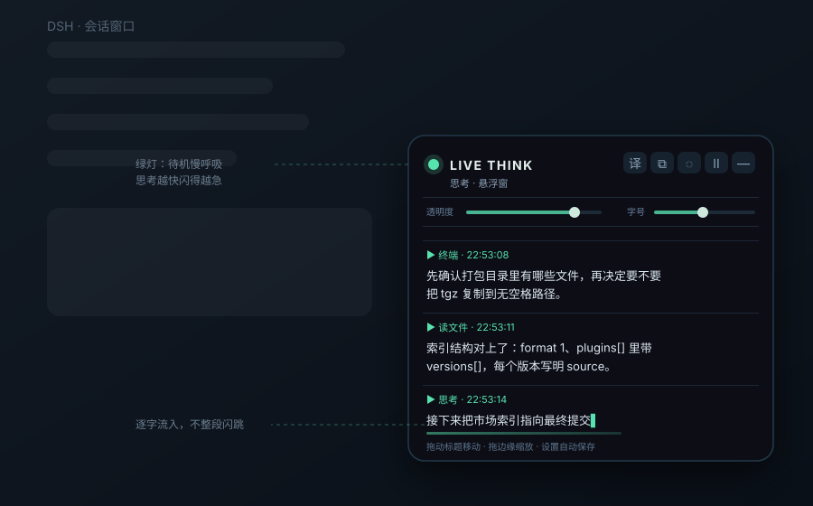

<div align="center">
  <h1>DSH Think Overlay</h1>
  <p><strong>把 DeepSeek Harness 的实时思考，抽成一扇看得见、摸得着的悬浮窗。</strong></p>
  <p>逐字流式 · 绿灯跟速 · 自动英译中</p>
  <p>
    <a href="README.md"></a>
    <a href="README.en.md"></a>
  </p>
  <p>
    <a href="https://github.com/hcycyxx/dsh-think-overlay/releases"></a>
    <a href="https://github.com/hcycyxx/dsh-think-overlay/stargazers"></a>
    <a href="LICENSE"></a>
  </p>
</div>

默认把正在产生的思考内容，一个字一个字地流进屏幕右下角的置顶半透明窗口；左上角绿灯的呼吸频率跟着吐字速度走，待机时缓慢明暗，思考越快闪得越急。英文思考自动翻成中文。窗口可拖动、缩放、点击穿透，也能一键弹成独立小窗，盖在别的程序上面。

这是社区界面插件，适用于 DSH Web 和使用同一界面的桌面版；TUI 不显示插件界面。它从更早那个「PowerShell + WPF + 读磁盘会话日志 + 依赖翻译插件」的悬浮窗重写而来，现在是标准 DSH 客户端插件：装好即启用，零外部依赖，无须重建前端产物。

**[下载 0.2.0 源码与中文文档](https://github.com/hcycyxx/dsh-think-overlay/releases/download/v0.2.0/dsh-think-overlay-v0.2.0-source-docs-20261109_v2.zip)** · [版本下载页](https://github.com/hcycyxx/dsh-think-overlay/releases/tag/v0.2.0)

## 快速安装

当前版本为 **0.2.0**，优先使用 [插件市场](#通过插件市场推荐) 或 [Release 离线安装包](https://github.com/hcycyxx/dsh-think-overlay/releases/download/v0.2.0/dsh-think-overlay-0.2.0.tgz)。

下载 tgz 后，用实际文件路径安装并重启对应实例：

```sh
dsh plugin --profile web add ./dsh-think-overlay-0.2.0.tgz
```

桌面版也可通过插件管理界面安装。`@latest` 只有在 npm 已发布并可查询到包后才适用，不能把它作为当前已验证的安装入口。

## 效果预览



窗口固定在页面右下角，默认宽 428、高 380、透明度 0.9。思考内容按条分隔，每条带工具名与时间；位置、大小、透明度、字号、穿透、翻译开关都会记住，下次打开还在原处。点击 `⧉` 可弹出独立小窗，与主窗逐字同步、绿灯同步。

> 示意图为静态绘制，用于说明布局，不是运行截图；窗口不读取截图中的任何数据。

## 功能

- **逐字流式**：思考内容一个字一个字往外吐，不整段闪跳。主窗是唯一的打字机，独立小窗直接显示已吐出的片段，两边一样顺滑。
- **绿灯跟速**：左上角绿灯频率随吐字速度平滑变化（待机约 0.29 Hz 缓慢呼吸，活跃最高约 1.8 Hz）。用连续相位驱动，改速度不会让动画相位重启，肉眼不跳变。
- **自动英译中**：英文思考自动翻成中文。优先走 DSH 自带翻译通道（本地 Node 侧），失败降级到公共翻译端点，仍失败则显示英文原文并每 6~18 秒自动重试最多 4 次。「译」按钮可随时开关，关掉后已翻好的退回原文。
- **独立小窗**：`⧉` 弹出单独窗口，可置顶盖在别的程序上；主窗与小窗经消息通道同步，逐字结果与绿灯状态一致。
- **全套窗口操作**：拖标题移动、拖四边四角缩放、两个滑杆调透明度与字号、点击穿透、收起成小胶囊、清空、暂停跟随。
- **设置与记忆**：DSH 设置里出现「思考悬浮窗」一栏；全部偏好保存在当前界面的 `localStorage`（`dsh-think-overlay.cfg.v1`），卸载不会清除。

取数只读 DSH 页面已渲染的思考行 `[data-variant="think"]` / `[data-chat-group-part="reasoning"]`，不读磁盘会话日志、不依赖「思考过程机器翻译」插件、不额外加载历史。折叠的思考行也能抓到摘要，展开后抓全文。DSH 若改动思考行结构，窗口不会报错，只是暂时没有新内容。

> 英译中会把**英文思考文本**发到翻译服务：优先 DSH 自带通道，降级时才发往 Google / MyMemory 公共端点。介意的话关掉「译」即可，此时纯本地抓页面、不联网。除翻译外，插件不注册模型工具、不执行命令、不发送其他网络请求。

## 安装

### 通过插件市场（推荐）

1. 打开 **插件 → 实验性插件**，启用 **自定义插件市场 / Custom plugin markets**（部分版本显示为 Custom plugin indexes）。
2. 进入 **发现 / Discover → 添加索引源 / Add index source**。已有索引时，可在市场菜单选择 **管理索引源…**。
3. 添加以下地址，选择 **hcycyxx 思考悬浮窗**，搜索 `dsh-think-overlay`，确认来源为 Git 仓库 `hcycyxx/dsh-think-overlay` 后安装。

```text
https://raw.githubusercontent.com/hcycyxx/dsh-think-overlay/main/market/index.json
```

按提示重启；桌面版刷新网页即可。索引源按 profile 保存，其他用户需要各自添加；排查方法见 [Discover 安装说明](docs/DISCOVER.md)。本索引使用 **Git 源**，无需 npm 账号即可安装。

### 命令行或离线安装

```sh
# 安装最新版到 Web profile（发布到 npm 后可用）
dsh plugin --profile web add dsh-think-overlay@latest

# 或安装固定版本
dsh plugin --profile web add dsh-think-overlay@0.2.0
```

离线安装可先从 [Releases](https://github.com/hcycyxx/dsh-think-overlay/releases) 下载 `dsh-think-overlay-0.2.0.tgz`，再使用实际文件名：

```sh
dsh plugin --profile web add ./dsh-think-overlay-0.2.0.tgz
```

桌面版可直接使用**插件管理界面**：填 `file:` 完整路径安装 tgz，或指向 clone 下来的仓库目录：

```
file:C:/路径/dsh-think-overlay-0.2.0.tgz
file:C:/路径/dsh-think-overlay
```

安装后重启对应 DSH 实例。已验证的桌面版也可用其自带 CLI 管理 `desktop` profile；不要直接修改桌面应用安装目录。仓库根目录就是插件包根目录（`package.json` 在最外层），直接填目录即可。

### 发布到 npm

`@latest` 方式需要先发布到 npm。本仓库带一个 [发布工作流](.github/workflows/publish.yml)：在仓库 Settings 添加 `NPM_TOKEN` secret 后，在 Actions 里手动运行一次 **Publish to npm**（或推送 `v*` tag）即可发布当前版本；也可本地执行：

```sh
npm publish --access public
```

发布并确认 `https://registry.npmjs.org` 可查询后，`@latest` 命令即可用。

## 设置

打开 **设置 → 插件 → 思考悬浮窗**，或直接操作窗口标题栏：

| 按钮 | 作用 |
| --- | --- |
| `译` | 英译中开关，亮着为开 |
| `⧉` | 弹出独立小窗 |
| `◌` | 点击穿透，鼠标直接穿过去 |
| `Ⅱ` | 暂停跟随，再点继续 |
| `⌫` | 清空当前内容 |
| `—` | 收起成「💡 思考悬浮窗」小胶囊 |

- **移动**：按住标题栏拖；**缩放**：拖四边四角。
- **透明度 / 字号**：标题下方两个滑杆，实时生效。
- **退出穿透**：开启穿透后页面右下出现「🔒 退出穿透」；独立小窗里按 `Esc` 也可退出。
- **盖住别的程序**：`⧉` 弹出小窗后点「置顶」。宿主未开放置顶接口时按钮显示「置顶*」，用系统窗口菜单或 PowerToys「总在最前」手动置顶即可，数据仍实时同步。

首次安装和恢复默认时使用以下组合：

| 项目 | 默认值 |
| --- | --- |
| 宽 × 高 | 428 × 380 |
| 位置 | 右下角（距边 28 px） |
| 透明度 | 0.9 |
| 字号 | 15 px |
| 点击穿透 | 关 |
| 英译中 | 开 |

## 兼容性与数据

0.2.0 不按 DSH 版本号阻止安装或加载；这不等于未来版本都已测试。已在 Windows 桌面版（Electron，DSH 0.2.2-rc.1）实测安装与加载；Web profile、macOS 与 Linux 桌面版的持续运行仍属未验证范围。

插件读取已显示的聊天结构、元素尺寸与当前会话已加载的思考行，不额外加载历史；不注册模型工具、不执行命令。英译中降级时会向公共翻译端点发送英文思考文本，其余不发送网络请求。设置保存在当前界面的 `localStorage`（`dsh-think-overlay.cfg.v1`）；卸载不会清除偏好。若存储不可用，插件按默认值运行，恢复后再次调整即可。

想让内容开始流入，随便让模型回答一次问题、产生一段思考即可。

## 文档

| 文档 | 内容 |
| --- | --- |
| [Discover 安装](docs/DISCOVER.md) | 添加索引源、安装与排查 |
| [English README](README.en.md) | 英文介绍 |
| [更新日志](CHANGELOG.md) | 版本变更 |
| [市场索引](market/index.json) | 自托管的 Discover 索引 |

## 卸载

```sh
dsh plugin --profile web remove dsh-think-overlay
```

重启对应实例；桌面版可使用插件管理界面。无须删除整个 DSH profile。

## 开发与验证

需要 Node.js 22 或更新版本。运行文件已入库，无须构建；无框架、无运行时依赖、无硬编码路径。

```sh
node --check client.js
node --check index.js
npm pack                       # 生成可分发的 tgz
```

改了工作区源码后必须重新 `npm pack` + 重新安装，因为安装到 profile 里的是拷贝，不是链接。提交问题时请提供 DSH 版本与系统，避免附带私人聊天内容。

| 文件 | 作用 |
| --- | --- |
| `package.json` | 插件清单（版本、`dsh.client` 注入配置） |
| `cordis.patch.yml` | 宿主侧条目（纯客户端插件，空壳） |
| `index.js` | 宿主侧入口（空） |
| `client.js` | 全部实现：抓思考行、逐字流式、绿灯跟速、英译中、拖拽缩放、配置持久化、独立小窗、设置页 |
| `icon.svg` | 插件图标 |

<!-- jack-white-rice-support:start -->
## 请大肥鱼吃大白饭 🍚

如果这个项目帮到了你，欢迎请大肥鱼吃一碗大白饭。自愿投喂，量力而行，感谢支持！

<p>
  <a href="assets/support/alipay-jack-v1.jpg"></a>
  <a href="assets/support/rice-meme-v1.png"></a>
</p>
<!-- jack-white-rice-support:end -->

## 许可

MIT，见 [LICENSE](LICENSE)。
